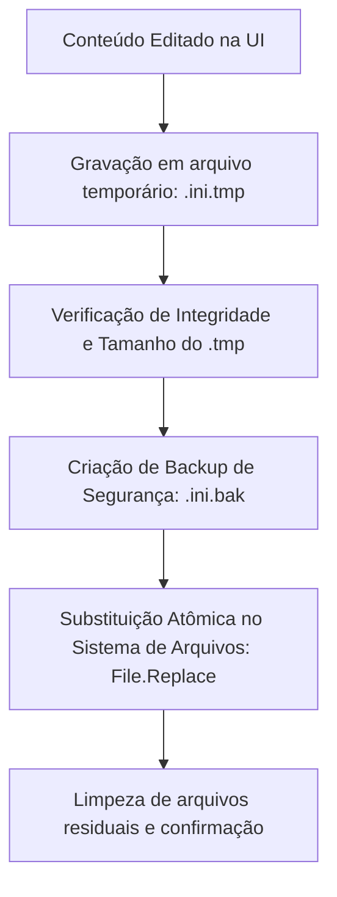

# 💾 TOTVSHub — Scanner, Configurações e Gravação Atômica

## 🔎 Scanner de Ambientes

O motor de escaneamento em `MainWindow.Scanner.cs` é responsável por descobrir servidores Protheus em diretórios base configurados pelo usuário.

### Regras de Mapeamento de Portas e Serviços
O scanner lê o arquivo `appserver.ini` e resolve dinamicamente:
- **Porta WebApp**: Seção `[WEBAPP] : Port` ou seção customizada mapeada.
- **Porta REST**: Seção `[HTTPREST] : Port` ou seção `[HTTP]`.
- **Porta TCP**: Seção do ambiente Protheus (`[<ambiente>] : Port`).
- **Serviços Web**: Seção `[WEBSERVICE]`.
- **DBAlias e DBPort**: Seção do TopConnect/DBAccess vinculada ao ambiente.

### Configuração de Regras Dinâmicas (`[Seção] : Chave`)
Na tela de Configurações, o usuário pode definir regras customizadas para associar valores do `.ini` aos metadados dos cards:
- Notação visual padronizada: `[Seção] : Chave` (substituindo o antigo símbolo `>`).
- Suporte à tag `<ambiente>`, que representa automaticamente a seção principal de cada base cadastrada.

---

## 🔒 Gravação Atômica Anti-Corrupção (Atomic File Replacement)

Um dos maiores riscos ao editar arquivos `appserver.ini` em produção são quedas de energia, travamentos do SO ou concorrência de escrita, que poderiam corromper o arquivo e deixar o ERP inoperante.

O TOTVSHub implementa um mecanismo de gravação atômica estrito em 4 passos:

1. **Gravação no Arquivo Temporário (`.tmp`)**: O novo conteúdo é gravado em um arquivo intermediário (`appserver.ini.tmp`) com codificação UTF-8 ou ANSI/Windows-1252 preservada.
2. **Cópia de Backup (`.bak`)**: Antes de alterar o arquivo original, cria-se ou atualiza-se o arquivo `.ini.bak`.
3. **Substituição Atômica (`File.Replace`)**:
   - Utiliza a chamada Win32 nativa `ReplaceFile` encapsulada pelo .NET.
   - A operação garante que ou o arquivo é substituído por completo, ou a versão anterior permanece 100% intacta. Em nenhum momento o arquivo original fica com tamanho zero ou cortado ao meio.
4. **Sanitização de Caminhos (Anti-Path Traversal)**:
   - Todo acesso a diretórios ou arquivos passa por `Path.GetFullPath`, validando se o arquivo pertence a diretórios legítimos e impedindo qualquer tentativa de navegação para fora de diretórios raiz via sequências `../` ou caminhos relativos maliciosos.
