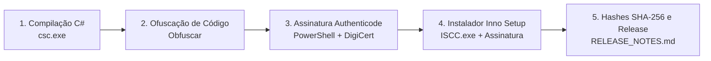

# 🛠️ TOTVSHub — Pipeline de Build, Ofuscação e Assinatura

O processo de construção do TOTVSHub é 100% automatizado através do script mestre `pipeline.bat`.

---

## ⚡ Fluxo de Execução do `pipeline.bat`

O pipeline opera em 5 etapas sequenciais com validação de código de saída (`errorlevel`) em cada transição:

### 1ª Etapa: Compilação (`scripts/compilar.bat`)
- Utiliza o compilador nativo `csc.exe` do .NET Framework 4.8 (`C:\Windows\Microsoft.NET\Framework64\v4.0.30319\csc.exe`).
- Incorpora o manifesto `assets/app.manifest` e o ícone `assets/totvs_white.ico`.
- Inclui mecanismo de rotação de binários (`TOTVSHub.exe -> TOTVSHub.exe.old`) caso o executável esteja em execução, impedindo erros `CS0016` de arquivo bloqueado.

### 2ª Etapa: Ofuscação de Código (`scripts/ofuscar.bat`)
- Utiliza o **Obfuscar** com configuração declarada em `scripts/obfuscar.xml`:
  - **Renomeação de Símbolos**: Variáveis, métodos, campos e tipos privados são ofuscados.
  - **Criptografia de Strings**: Oculta URLs, nomes de chaves e constantes textuais do executável.
  - **Achatamento de Fluxo**: Dificulta a descompilação por ferramentas como ILSpy, dnSpy e dotPeek.
- O binário protegido é gravado em `Dist_Protected\TOTVSHub.exe`.

### 3ª Etapa: Assinatura Digital do Executável (`scripts/assinar.bat`)
- Invoca o script PowerShell `scripts/assinar.ps1`.
- Procura automaticamente o certificado de Code Signing no repositório do Windows (`Cert:\CurrentUser\My` e `Cert:\LocalMachine\My`).
- Aplica assinatura Authenticode SHA-256 com carimbo de tempo RFC 3161 (`http://timestamp.digicert.com`).

### 4ª Etapa: Geração e Assinatura do Instalador (`scripts/gerar_instalador.bat`)
- Localiza o compilador Inno Setup (`ISCC.exe`) nos diretórios padrão (`D:\Inno Setup 7`, `%ProgramFiles%`, `%LocalAppData%` e Registro do Windows).
- Compila o script `scripts/installer.iss` empacotando o binário protegido, ícone, SVG e manifesto.
- Assina digitalmente o instalador resultante (`Output\TOTVSHub_Setup_v*.exe`).

### 5ª Etapa: Geração de Hashes e Documentação de Release (`scripts/gerar_release.bat`)
- Executa `scripts/gerar_release.ps1`.
- Calcula os hashes SHA-256 oficiais do instalador e do binário protegido.
- Atualiza automaticamente o arquivo `RELEASE_NOTES.md` com os hashes, links de verificação e texto formatado para publicação no LinkedIn e GitHub.
